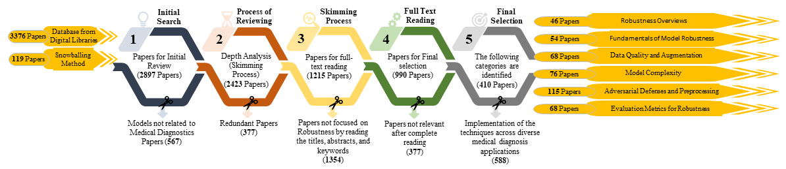

# Medical-DL-Robustness

A survey of robustness, security, and adversarial risk in deep learning for medical diagnosis.

[](https://doi.org/10.1007/s10462-024-11005-9)
[](https://github.com/haseebjaved123/MedicalDL_AIR_2025)



## What it is

This survey examines when diagnostic deep-learning models keep working under noisy or adversarial inputs, and which defenses and metrics the literature uses.

## Why it matters

A model that is accurate on a clean test set can still fail when the input is perturbed. In medical imaging and clinical prediction, that failure is a safety problem as well as an accuracy problem.

## Method

The review organizes prior work around model complexity, training-data quality, hyperparameters, adversarial attacks, privacy attacks, defenses such as adversarial training and input preprocessing, and robustness metrics. Figure 1 records the screening flow used for the review, from database search and snowballing through full-text selection.

## Citation

```bibtex
@article{javed2025robustness,
  title={Robustness in deep learning models for medical diagnostics: security and adversarial challenges towards robust AI applications},
  author={Javed, Haseeb and El-Sappagh, Shaker and Abuhmed, Tamer},
  journal={Artificial Intelligence Review},
  volume={58},
  number={1},
  year={2025},
  doi={10.1007/s10462-024-11005-9}
}
```

## License

MIT for the repository text and code. The survey itself is published by Springer.
